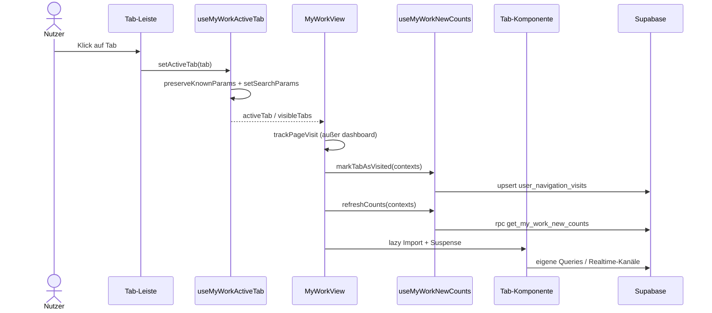
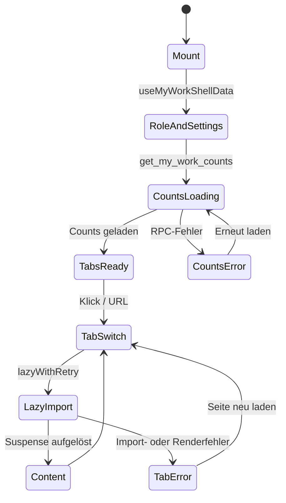
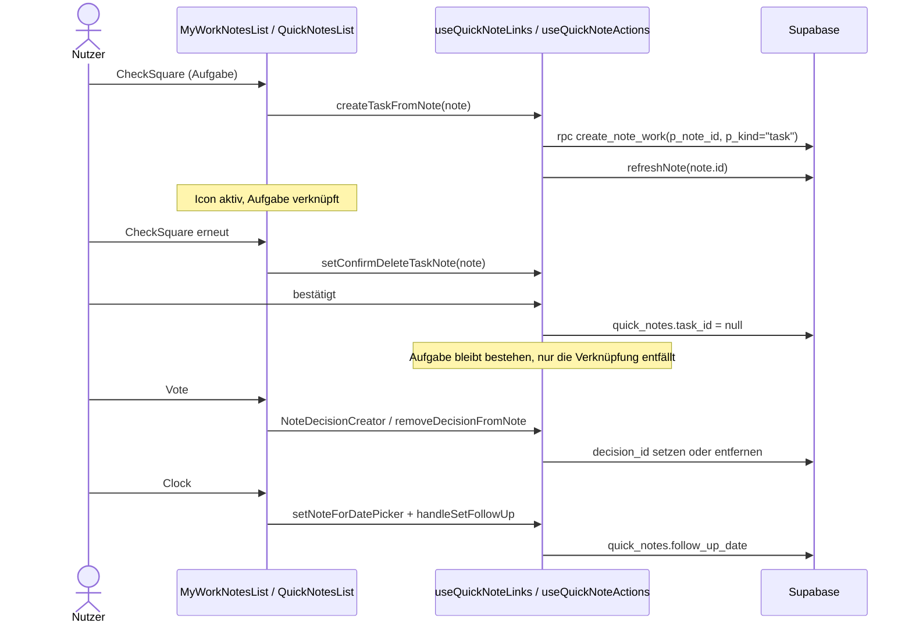

# „Meine Arbeit“ – Architektur und Debug-Landkarte

Stand: 2026-11-24

Diese Doku ersetzt die frühere Superadmin-Seite „Meine Arbeit Übersicht“ (`mywork-overview`). Der Menüpunkt und die statische Diagramm-Komponente wurden entfernt; die noch gültigen Inhalte stehen hier, korrigiert auf den aktuellen Code. Handler-Namen in dieser Datei werden mit `npm run check:diagram-drift` gegen den Produktivcode geprüft.

## 1. Einstieg und Route

- `/mywork` rendert `src/pages/Index.tsx` und dort `MyWorkView` aus `src/features/dashboard/components/MyWorkView.tsx` – eingefasst in einen Section-ErrorBoundary.
- `/` leitet auf `/mywork` um, `/dashboard/*` auf `/mywork?tab=dashboard`.
- `/redaktion` leitet auf `/mywork?tab=redaktion`, `/vorgaenge` auf `/mywork?tab=cases`.
- `MyWorkView` ist die Shell: Tab-Leiste, Neu-Menü, Count-Laden, Lazy-Rendering. Die Fachinhalte liegen in den Tab-Komponenten.

Der aktive Tab steht als `?tab=` in der URL. `shouldNormalizeMyWorkTab` schreibt den Parameter nur, solange `/mywork` die aktive Route ist, damit ein gerade noch gerenderter Tab nicht die URL eines anderen Bereichs überschreibt.

## 2. Tabs

Quelle: `src/components/my-work/myWorkTabs.ts` (`MY_WORK_TABS`).

| Tab-Wert | Label | Icon | Zähler | Sichtbarkeit |
|---|---|---|---|---|
| `dashboard` | – (Logo-Tab) | App-Logo | – | alle Rollen |
| `capture` | Quick Notes | PencilSparkles | – | alle Rollen |
| `cases` | Vorgänge | Briefcase | `cases` | alle Rollen |
| `tasks` | Aufgaben | CheckSquare | `tasks` | alle Rollen |
| `decisions` | Entscheidungen | Vote | `decisions` | alle Rollen |
| `jourFixe` | Jour fixe & Planungen | Calendar | `jourFixe` | alle Rollen |
| `redaktion` | Redaktion | Lightbulb | – | alle Rollen, nur bei aktivem Modul `module.editorial` |
| `time` | Meine Zeit | Clock | – | nur Mitarbeiter, Praktikant, Büroleitung |
| `team` | Team | Users | `team` | nur Abgeordneter und Büroleitung |

`feedbackfeed` („Rückmeldungen“) ist **kein Reiter** mehr. Der Wert steht nur noch in `MY_WORK_ALLOWED_TABS`; da die Tab-Auflösung den aktiven Tab gegen die sichtbaren `MY_WORK_TABS` prüft, landet ein Altlink auf dem ersten sichtbaren Tab.

### Legacy-Aliase

`LEGACY_TAB_MAP` überführt alte Links:

| Alt | Neu |
|---|---|
| `caseitems` | `cases` |
| `casefiles` | `cases` |
| `appointmentfeedback` | `feedbackfeed` (faktisch Fallback auf Übersicht) |
| `plannings` | `jourFixe` |

### Aktions-Parameter

`MY_WORK_ACTION_TAB_MAP` leitet `?action=` auf einen Tab um:

| Action | Tab |
|---|---|
| `create-task` | `tasks` |
| `create-decision` | `decisions` |
| `create-meeting` | `jourFixe` |
| `create-caseitem` | `cases` |
| `create-casefile` | `cases` |
| `create-eventplanning` | `jourFixe` |

Beim Tabwechsel erhalten `action`, `highlight`, `scope`, `period`, `withAttachments`, `withTasks`, `caseItemId`, `caseFileId` (und `task` bei `tasks`) ihre Werte.

## 3. Rollen und Sichtbarkeit

Die Rolle kommt aus der aktiven Mandanten-Mitgliedschaft (`user_tenant_memberships`, `is_active`), mit Fallback auf `user_roles`; aufgelöst in `src/hooks/useResolvedUserRole.ts` (10 Minuten staleTime). Die Tab-Regeln liegen in `src/components/my-work/tabVisibility.ts` (`canViewTab`).

| Regel | Rollen |
|---|---|
| `teamLeadsOnly` | `abgeordneter`, `bueroleitung` |
| `employeeOnly` | `mitarbeiter`, `praktikant`, `bueroleitung` |
| `feedbackFeedCoreRolesOnly` | `mitarbeiter`, `bueroleitung`, `abgeordneter` (nur noch für den nicht sichtbaren `feedbackfeed`-Zweig) |

Daraus ergibt sich:

| Rolle | Tabs |
|---|---|
| `abgeordneter` | dashboard, capture, cases, tasks, decisions, jourFixe, redaktion*, team |
| `bueroleitung` | dashboard, capture, cases, tasks, decisions, jourFixe, redaktion*, time, team |
| `mitarbeiter` | dashboard, capture, cases, tasks, decisions, jourFixe, redaktion*, time |
| `praktikant` | dashboard, capture, cases, tasks, decisions, jourFixe, redaktion*, time |

\* `redaktion` nur, wenn das Mandantenmodul `module.editorial` aktiv ist (`useTenantModuleGate`).

## 4. Zähler und Neu-Markierungen

Die Shell nutzt zwei getrennte Quellen:

| Zweck | Hook | RPC / Tabelle | Verhalten |
|---|---|---|---|
| Gesamtzahlen | `useMyWorkShellData` (`src/components/my-work/hooks/useMyWorkShellData.ts`) | `get_my_work_counts(p_user_id, p_include_team)` | Lädt beim Start; `p_include_team` nur für Abgeordneter/Büroleitung. `cases` ist die Summe aus `caseItems` + `caseFiles`. Fehler setzen `countLoadError` und `realtimeStatus = "degraded"`. |
| Neu-Punkte | `useMyWorkNewCounts` (`src/hooks/useMyWorkNewCounts.tsx`) | `get_my_work_new_counts(p_user_id, p_contexts)` | Query mit 10 s staleTime; Aktualisierungen werden auf 1200 ms gedrosselt. Fehlt die RPC, bleiben die Werte 0. |
| Besuche | derselbe Hook | `user_navigation_visits` (Upsert) | `markTabAsVisited` setzt den Zähler im Cache auf 0 und schreibt zusätzlich `navigation_visit_sync` in `localStorage`. |

Wichtig für die Anzeige: `totalCounts` wird zwar geladen, aber derzeit von keiner Komponente gerendert. Sichtbar sind nur der Neu-Punkt am Tab-Icon (`newCounts`) und der Freigaben-Zähler an „Redaktion“ (`useOpenApprovalCount`, nur bei aktivem Redaktionsmodul).

Es gibt in der Shell **keinen** Supabase-Realtime-Kanal für die Zähler. Die Gesamtzahlen lädt sie beim Start (und über „Erneut laden“), die Neu-Zähler beim Tabwechsel. `realtimeStatus` ist nur ein lokaler Statuswert (`connecting` / `connected` / `degraded`), der nach dem Count-Laden gesetzt wird. Tab-Komponenten betreiben eigene Kanäle, z. B.:

| Tab | Kanal / Tabellen |
|---|---|
| `time` | `time_entries` (`MyWorkTimeTrackingTab.tsx`) |
| `jourFixe` | `event_plannings`, `event_planning_checklist_items` (`MyWorkPlanningsTab.tsx`, `MyWorkPlanungsKartenSection.tsx`) |
| `team` | `time_entries`, `employee_meeting_requests`, `leave_requests`, `employee_settings` (`useMyWorkTeamData.ts`) |
| `cases` | `case_items`, `case_files`, `user_tenant_memberships`, `profiles` (`useCaseWorkspaceData.ts`) |

## 5. Ablauf beim Tabwechsel

`MY_WORK_TAB_VISIT_CONTEXTS` ordnet Tabs den Besuchs-Kontexten zu: `tasks`, `decisions`, `jourFixe`, `cases` (`mywork_caseitems` + `mywork_casefiles`), `team`, `feedbackfeed`; `dashboard`, `capture`, `redaktion` und `time` haben keinen Kontext.

## 6. Zustände, Laden, Fehler

- Tab-Inhalte werden per `lazyWithRetry` nachgeladen; der Suspense-Fallback zeigt „Bereich wird geladen…“ bzw. „Lade Daten…“.
- Pro Tab fängt ein `ErrorBoundary` Fehler ab und zeigt `MyWorkTabErrorState` mit Neuladen-Aktion.
- Ein Count-Fehler erscheint als Alert über dem Inhalt mit „Erneut laden“; der Rest der Seite bleibt nutzbar.
- Ein unbekannter oder unsichtbarer `?tab=`-Wert fällt auf den ersten sichtbaren Tab zurück (in der Regel `dashboard`).

## 7. Quick Notes (Tab `capture`)

Aufbau:

- `MyWorkQuickCapture` – Eingabe, Pin, Farbe, Speichern, „als Aufgabe“.
- `MyWorkNotesList` – Liste, Archiv/Papierkorb, globale Freigabe.
- Gemeinsame Darstellung und Dialoge: `src/components/shared/QuickNotesList.tsx`, `NoteCard.tsx`, `NoteDialogs.tsx`.
- Daten und Aktionen: `src/features/quick-notes/` (`useQuickNotes`, `useQuickNoteLinks`, `useQuickNoteActions`, `useQuickNoteDialogs`, `useQuickNotesData`).
- Speicher-/Offline-/Mandantenregeln: `docs/quick-notes/offline-and-security.md`.

Verknüpfungen (Handler in `QuickNotesList.tsx`, Logik in `src/features/quick-notes/`):

| Handler | Auslöser | Wirkung |
|---|---|---|
| `createTaskFromNote` | CheckSquare ohne `task_id` | Synchronisiert zuerst; blockt bei offenen Schreibvorgängen; ruft `create_note_work(p_note_id, p_kind => "task")` auf und lädt die Notiz neu. |
| `setConfirmDeleteTaskNote` | CheckSquare mit `task_id` | Öffnet den Bestätigungsdialog zum Entfernen der Verknüpfung. |
| `removeTaskFromNote` | Bestätigung im Dialog | Setzt `quick_notes.task_id` auf `null`. Die Aufgabe selbst wird dabei **nicht** gelöscht. |
| `removeDecisionFromNote` | Vote mit `decision_id` | Setzt `quick_notes.decision_id` auf `null` (nach Bestätigung). |
| `setNoteForDatePicker` | Clock | Öffnet den Datumsdialog für die Notiz. |
| `handleSetFollowUp` | Datum gewählt/entfernt | Patched `follow_up_date` über den Repository-Layer und schließt den Dialog. |
| `loadNotes` | nach Dialog-/Metadatenänderungen | Invalidiert die Notiz-Query des Repositories. |

Zusätzlich: `createCaseItemFromNote` legt über `create_note_work(..., p_kind => "case")` einen Vorgang an; `useQuickNoteActions` archiviert (`is_archived`), verschiebt in den Papierkorb (`deleted_at`, `permanent_delete_at` = +30 Tage) und setzt Wiedervorlagen.

## 8. Code-Map

| Concern | Ort |
|---|---|
| Route und Shell | `src/pages/Index.tsx`, `src/features/dashboard/components/MyWorkView.tsx` |
| Tab-Konfiguration, Legacy-Aliase, Aktionen | `src/components/my-work/myWorkTabs.ts` |
| Tab-Auflösung und URL-Sync | `src/components/my-work/hooks/useMyWorkActiveTab.ts` |
| Rollenauflösung | `src/hooks/useResolvedUserRole.ts` |
| Sichtbarkeitsregeln | `src/components/my-work/tabVisibility.ts` |
| Counts / Rolle / Einstellungen | `src/components/my-work/hooks/useMyWorkShellData.ts` |
| Neu-Zähler und Besuche | `src/hooks/useMyWorkNewCounts.tsx` |
| Tab-Inhalte | `MyWorkDashboardTab`, `MyWorkQuickCapture` + `MyWorkNotesList`, `MyWorkTasksTab`, `MyWorkDecisionsTab`, `MyWorkTerminePlanungTab`, `MyWorkCasesWorkspace`, `MyWorkRedaktionTab`, `MyWorkTimeTrackingTab`, `MyWorkTeamTab` |
| Quick-Notes-Datenmodell | `src/features/quick-notes/` |
| Quick-Notes-UI | `src/components/shared/QuickNotesList.tsx`, `NoteDialogs.tsx` |

## 9. Prüfungen

- `npm run check:diagram-drift` prüft, dass die sieben oben genannten Quick-Notes-Handler in dieser Doku **und** im Produktivcode vorkommen. Der Check hing früher an der gelöschten Admin-Seite und den Diagramm-Konstanten.
- `npm run test:role-smoke` prüft eine lokale Kopie der Rollenflags, nicht die echte `canViewTab`-Implementierung. Maßgeblich bleibt `tabVisibility.ts`.
- Es gibt keinen automatischen Check für die Tab-Liste in dieser Doku. Änderungen an `MY_WORK_TABS` müssen hier mitgezogen werden.

## 10. Nicht mehr zutreffend

Frühere Aussagen der entfernten Admin-Seite, die bewusst nicht übernommen wurden:

- Quellpfade `src/components/MyWorkView.tsx`, `BASE_TABS`, `getDisplayCount` – diese existieren nicht mehr.
- Eigenständige Tabs `casefiles` und `plannings` – beide sind nur noch Aliase auf `cases` bzw. `jourFixe`.
- Ein `feedbackfeed`-Reiter – der Wert ist kein sichtbarer Tab mehr.
- Ein Realtime-Kanal der Shell, der Counts automatisch neu lädt – die Shell lädt beim Start und beim Tabwechsel; Realtime liegt in den Tab-Komponenten.
- „Gesamt“-Badges in der Tab-Leiste – angezeigt werden nur Neu-Punkte und der Freigaben-Zähler.
- Das Löschen der Aufgabe beim Entfernen der Notiz-Verknüpfung – es wird nur `quick_notes.task_id` geleert.
